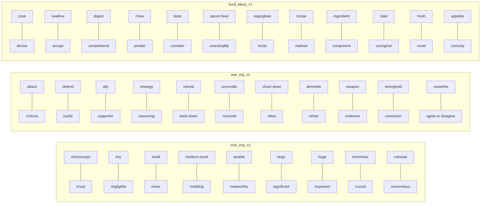

# Wave 1 — the mappings

The correspondence **T** for each family pair: which concept in family *A* is paired with which in family *B*. T is fixed in advance, from published sources plus flagged judgement; it is what the permutation null reshuffles, and the generator never sees it (each cloud's training text is written in independent calls).

**94 steering vectors** across four experiments, trained on `gemma-2-2b-it` at layers 5/10/15/20.

| experiment | source domain *A* | target domain *B* | shape | pairs | vectors |
|---|---|---|---|---|---|
| `size_imp_v1` | physical size | importance | ordered ladder | 9 | 18 |
| `war_arg_v1` | literal war | argument / debate | categorical | 11 | 22 |
| `food_ideas_v1` | literal food & cooking | ideas / cognition | categorical | 12 | 24 |
| `frames_v1` | five professional frames | (same, resliced by role) | role grid | 6 | 30 |

## IMPORTANCE IS SIZE  (`size_imp_v1`)

A rank-matched ladder: rung *i* of size pairs with rung *i* of importance. Both ladders are written smallest-first, so rung 1 is the low end of each.

| # | size (*A*) | ↔ | importance (*B*) | sense of *A* | sense of *B* |
|---|---|---|---|---|---|
| 1 | **microscopic** | ↔ | **trivial** | an object so physically small it can only be made out under a microscope | a matter that carries no consequence at all |
| 2 | **tiny** | ↔ | **negligible** | an object of very small physical extent, easily lost in the hand | a matter whose consequence is too slight to be worth counting |
| 3 | **small** | ↔ | **minor** | an object of modest physical extent, comfortably held | a matter of slight consequence |
| 4 | **medium-sized** | ↔ | **middling** | an object of moderate physical extent, neither cramped nor sprawling | a matter of moderate consequence, neither pressing nor idle |
| 5 | **sizable** | ↔ | **noteworthy** | an object of appreciably large physical extent | a matter with enough consequence to be worth remarking on |
| 6 | **large** | ↔ | **significant** | an object of large physical extent, taking up real room | a matter that carries real consequence |
| 7 | **huge** | ↔ | **important** | an object of very large physical extent, dwarfing what is around it | a matter whose consequence makes it a priority |
| 8 | **enormous** | ↔ | **crucial** | an object of vast physical extent, hard to take in at once | a matter on whose outcome much else depends |
| 9 | **colossal** | ↔ | **momentous** | an object of overwhelming physical extent, on the scale of a mountain or a monument | a matter whose consequence will be felt for a long time afterwards |

*Slide-ready pair list:*  microscopic → trivial · tiny → negligible · small → minor · medium-sized → middling · sizable → noteworthy · large → significant · huge → important · enormous → crucial · colossal → momentous

## ARGUMENT IS WAR  (`war_arg_v1`)

Lakoff & Johnson's canonical mapping. The war side is always the *literal* military sense; the famous blended usages ("attack her argument") are held out as probes.

| # | war (*A*) | ↔ | argument (*B*) | sense of *A* | sense of *B* |
|---|---|---|---|---|---|
| 1 | **attack** | ↔ | **criticise** | an armed assault by one force on another's position, launched to take ground or inflict losses | pointing out what is wrong or weak in a claim someone has made |
| 2 | **defend** | ↔ | **justify** | a force holding a position against an assaulting enemy | setting out the grounds that show one's own claim is warranted |
| 3 | **ally** | ↔ | **supporter** | a force fighting alongside another under a shared cause | someone who publicly holds and backs the same view as another person |
| 4 | **strategy** | ↔ | **reasoning** | the overall plan by which a commander seeks to win a campaign | the connected sequence of steps by which someone gets to a conclusion |
| 5 | **retreat** | ↔ | **back down** | a force withdrawing from a position it can no longer hold | withdrawing a claim one had been maintaining |
| 6 | **surrender** | ↔ | **concede** | a force laying down its arms and submitting to the opposing side | granting that the other side is right about something |
| 7 | **shoot down** | ↔ | **rebut** | bringing an enemy aircraft down out of the sky with gunfire or a missile | answering a claim by giving reasons it does not hold |
| 8 | **demolish** | ↔ | **refute** | destroying a building, bridge or fortification outright by explosive or shellfire | showing conclusively that a claim is false |
| 9 | **weapon** | ↔ | **evidence** | an implement carried by a soldier or mounted on a vehicle for use in combat | the facts or testimony brought forward to make a claim credible |
| 10 | **stronghold** | ↔ | **conviction** | a fortified place a force holds and can fall back to | a belief someone holds so firmly that they will not give it up |
| 11 | **ceasefire** | ↔ | **agree to disagree** | an agreed halt to the fighting between two forces | two people settling on leaving a disagreement unresolved |

*Slide-ready pair list:*  attack → criticise · defend → justify · ally → supporter · strategy → reasoning · retreat → back down · surrender → concede · shoot down → rebut · demolish → refute · weapon → evidence · stronghold → conviction · ceasefire → agree to disagree

## IDEAS ARE FOOD  (`food_ideas_v1`)

The food side is always literal cooking or eating; "half-baked idea", "food for thought" and "hard to swallow" are held out as probes.

| # | food (*A*) | ↔ | ideas (*B*) | sense of *A* | sense of *B* |
|---|---|---|---|---|---|
| 1 | **cook** | ↔ | **devise** | preparing food by applying heat to it | working out a new idea or plan for the first time |
| 2 | **swallow** | ↔ | **accept** | passing a mouthful of food from the mouth down the throat | coming to hold that a claim someone has made is true |
| 3 | **digest** | ↔ | **comprehend** | the body slowly breaking food down after it has been eaten | coming to fully understand something that has been explained |
| 4 | **chew** | ↔ | **ponder** | working a mouthful of food between the teeth before swallowing | turning a question over in the mind at length before answering it |
| 5 | **taste** | ↔ | **consider** | putting a small amount of food on the tongue to judge its flavour | giving a proposal deliberate attention before deciding on it |
| 6 | **spoon-feed** | ↔ | **oversimplify** | putting food into another person's mouth with a spoon, as one does for an infant | making an explanation so simple that what matters is lost |
| 7 | **regurgitate** | ↔ | **recite** | bringing food back up out of the stomach undigested | repeating memorised material back word for word without understanding it |
| 8 | **recipe** | ↔ | **method** | written instructions for preparing a particular dish | a settled way of going about a task |
| 9 | **ingredient** | ↔ | **component** | one of the foodstuffs that goes into a dish | one of the parts a theory is built out of |
| 10 | **stale** | ↔ | **unoriginal** | food that has gone dry and old and is past being good to eat | an idea that many people have already had before |
| 11 | **fresh** | ↔ | **novel** | food newly picked, caught or made, not yet gone off | an idea nobody appears to have had before |
| 12 | **appetite** | ↔ | **curiosity** | the bodily hunger that makes someone want to eat | the wish to find out how something is or why it is so |

*Slide-ready pair list:*  cook → devise · swallow → accept · digest → comprehend · chew → ponder · taste → consider · spoon-feed → oversimplify · regurgitate → recite · recipe → method · ingredient → component · stale → unoriginal · fresh → novel · appetite → curiosity

## Parallel professional frames  (`frames_v1`)

Not a metaphor: five frames instantiating one role schema. The shared index is the **role**, so every pair of frames is a family pair (10 pairs from 5 frames). Read a row as one role across the professions, a column as one whole frame.

| role | general medical | legal | dentistry | residential real-estate | school teaching |
|---|---|---|---|---|---|
| PRACTITIONER | **doctor** | **lawyer** | **dentist** | **real-estate agent** | **teacher** |
| RECIPIENT | **patient** | **client** | **patient** | **vendor** | **student** |
| VENUE | **clinic** | **law firm** | **dental surgery** | **agency** | **school** |
| MATTER | **illness** | **lawsuit** | **toothache** | **property sale** | **lesson** |
| INTERVENTION | **treatment** | **representation** | **filling** | **auction** | **instruction** |
| ARTIFACT | **prescription** | **contract** | **dental chart** | **listing** | **report card** |

Optional row not currently generated: **OUTCOME** (no clean dentistry filler, so the grid would be ragged).

## Held-out figurative probes

Vocabulary deliberately withheld from every training text — it is where the metaphor is already lexicalised in English, so leaving it in would hand the alignment to the generator. Projected afterwards, once the alignment is established on disjoint vocabulary.

| experiment | held-out probes |
|---|---|
| `size_imp_v1` | *a big decision*, *a little problem*, *a weighty question*, *a monumental error*, *a giant of the field*, *small talk*, *a towering achievement*, *a slight oversight* |
| `war_arg_v1` | *attack her argument*, *defend a thesis*, *an indefensible claim*, *shot down my proposal*, *an entrenched position*, *a battle of ideas*, *a war of words*, *demolish an argument* |
| `food_ideas_v1` | *a half-baked idea*, *food for thought*, *hard to swallow*, *stew over it*, *a warmed-over theory*, *devour a book*, *spoon-fed answers*, *leaves a bad taste* |
| `frames_v1` | *a practice*, *a case*, *a settlement*, *a retainer*, *a consultation*, *a referral* |

## Diagram source (paste into Mermaid, or read as edge pairs)

